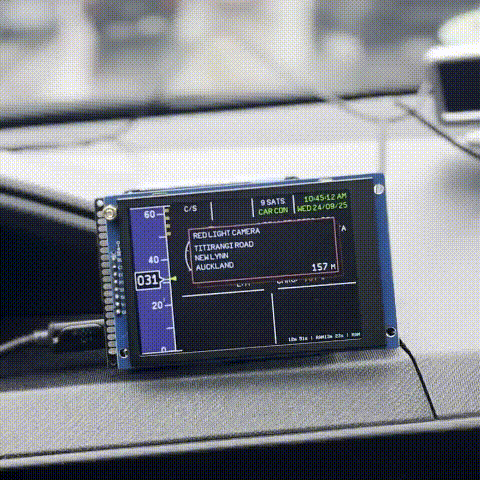
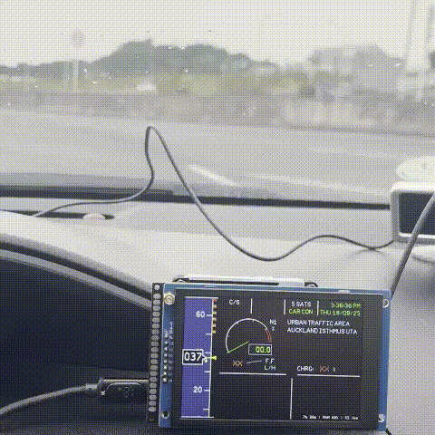
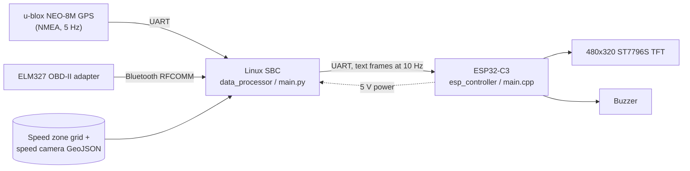
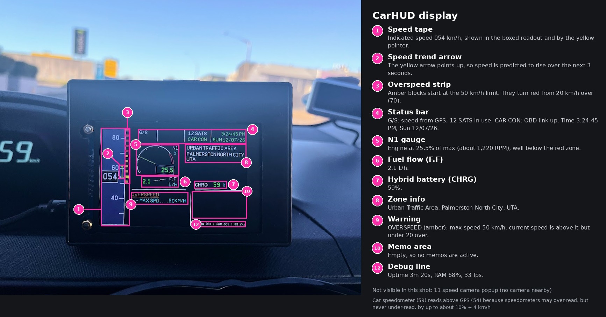
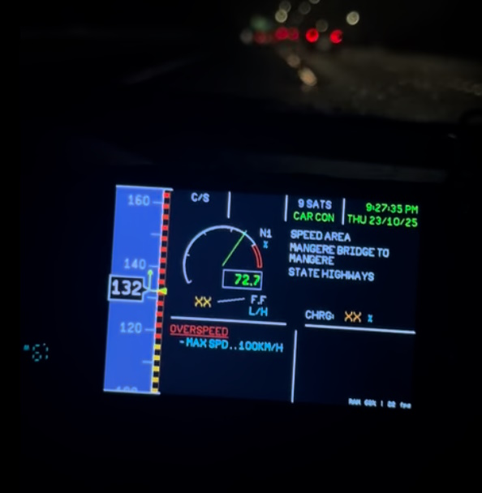
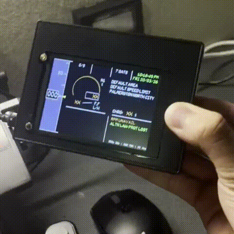

# CarHUD


**A heads-up display unit for any car, showing speed, RPM, and warnings for speed limits and speed cameras, inspired by the Airbus PFD.**

CarHUD combines GPS, the car's OBD-II data and a New Zealand speed-limit and speed-camera database into one glanceable display. The look and behaviour are borrowed from Airbus cockpit displays: a **PFD-style speed tape** with a trend vector and overspeed strip, an **N1-style gauge** for RPM, and **ECAM-style** warnings and memos in red, amber, green and cyan, with the same "XX" convention when data is unavailable.

---

## Demo

GIFs have no sound. The buzzer patterns are listed under [Buzzer patterns](#buzzer-patterns).

**Speed camera approach**


**Speed limit change**


---

## Table of contents

1. [Demo](#demo)
2. [Features](#features)
3. [How it works](#how-it-works)
4. [The display](#the-display)
5. [Hardware and components](#hardware-and-components)
6. [Enclosure and mounting](#enclosure-and-mounting)
7. [Project structure](#project-structure)
8. [Setup](#setup)
9. [Data pipeline](#data-pipeline)
10. [Configuration reference](#configuration-reference)
11. [Serial protocol](#serial-protocol)
12. [Warnings, memos and alerts](#warnings-memos-and-alerts)
13. [Algorithms in detail](#algorithms-in-detail)
14. [Performance and measurements](#performance-and-measurements)
15. [Vehicle compatibility](#vehicle-compatibility)
16. [Using CarHUD outside New Zealand](#using-carhud-outside-new-zealand)
17. [Why the MS33558 font?](#why-the-ms33558-font)
18. [Troubleshooting](#troubleshooting)
19. [Limitations and roadmap](#limitations-and-roadmap)
20. [Safety and legal](#safety-and-legal)
21. [Credits and licence](#credits-and-licence)

---

## Features

- **Speed tape** in the style of an Airbus PFD, with a boxed three-digit readout, smooth animation and a yellow **speed trend arrow** predicting your speed 3 seconds ahead.
- **Overspeed strip** that tracks the current speed limit: amber blocks for being over the limit, red blocks from 20 km/h over.
- **Automatic speed limits** from the NZTA National Speed Limit Register (NSLR), including **variable, seasonal, temporary and school-zone** limits that depend on the date and time.
- **Speed camera warnings** with an on-screen popup showing the camera type, street, suburb and distance, plus a buzzer chime. The popup flashes red if you are also speeding.
- **RPM gauge** (N1 style, shown as a percentage of max RPM with a red line).
- **Fuel flow** in L/h, estimated from the mass airflow sensor.
- **Hybrid battery state of charge** (OBD PID `015B`, answered by some hybrids).
- **Smart speed source selection**: uses the car's OBD speed when GPS is weak, and GPS speed when the car is not connected or GPS is strong (`C` or `G` is shown on the status bar).
- **Cockpit-style fault handling**: ECAM-style warnings for GPS or OBD failures, and "XX" in amber for stale data.
- **Self-test screen** on boot, as the ESP32 waits for the single-board computer to start sending data.
- **Wi-Fi status** and an `SSH READY` memo when the board is online.
- **Log files** for every run, with child processes logging through a queue.
- **Fully offline** while driving. All data is stored locally.

---

## How it works

CarHUD is split into two halves: a Linux single-board computer (SBC) that does the thinking, and an ESP32-C3 that only draws the screen and sounds the buzzer.



### The SBC side (`data_processor`)

`main.py` runs several concurrent tasks:

| Task | Type | Purpose |
|---|---|---|
| GPS reader | thread | Reads NMEA sentences, parses them with `pynmea2`, tracks position, time, satellites and GPS speed |
| OBD retriever | **process** | Talks to the ELM327 adapter over Bluetooth (RPM, speed, MAF, hybrid SoC) and reconnects automatically |
| ESP32 sender | thread | Packs the current state into a text frame and writes it out every 100 ms |
| Wi-Fi checker | thread | Opens a socket to `1.1.1.1:80` every 10 s to report connectivity |
| Zone and camera lookups | **process pool** (2 workers) | Runs the Shapely geometry work off the main loop so it never blocks the data flow |
| Main loop | main thread | Schedules lookups, merges results and computes the speed prediction |

State is shared between processes using a `multiprocessing.Manager` dict, and all processes log to one queue so there is a single, ordered log file per run (`log/<timestamp>.log`).

### The ESP32 side (`esp_controller`)

The firmware parses incoming frames, validates them (data older than a few seconds is marked invalid), derives warnings and memos, and redraws only the parts of the screen that changed using off-screen sprites. It runs an update cycle every 25 ms and shows loop stats (uptime, RAM, FPS) in the bottom-right corner.

### Speed source selection

| Source | Code | Used when |
|---|---|---|
| Car (OBD) | `C` | The car is connected and GPS has 7 or fewer satellites (this is also the startup default) |
| GPS | `G` | The car is not connected, or GPS has 8 or more satellites |
| Weighted GPS | `W` | Position-derived speed, used only by the optional GPS simulator |

When GPS is reliable (9+ satellites) the OBD speed query slows to once every 2 s to leave bandwidth for RPM and fuel flow.

---

## The display



| # | Element | Description |
|---|---|---|
| 1 | **Speed tape** | Scrolling scale (10 km/h per 50 px) with the current speed in a boxed readout |
| 2 | **Speed trend arrow** | Yellow vector showing predicted speed in 3 s; hidden when the change is under 1 km/h |
| 3 | **Overspeed strip** | Amber blocks above the limit, red blocks from 20 km/h over |
| 4 | **Status bar** | Speed source (`C/S`, `G/S`), satellite count, `CAR CON`, local time and date |
| 5 | **N1 gauge** | RPM as a percentage of max (4800 RPM), with a red line at 4000 RPM |
| 6 | **F.F** | Fuel flow in L/h |
| 7 | **CHRG** | Hybrid battery charge in % |
| 8 | **Zone info** | Variable speeds, zone reason (e.g. School Zone), zone name and area |
| 9 | **Warnings** | ECAM-style faults, sorted red then amber |
| 10 | **Memos** | Status notes, sorted red, amber, then green |
| 11 | **Speed camera popup** | Camera type, street, suburb and distance in metres; flashes when active |
| 12 | **Debug line** | Uptime, RAM use and frames per second, in small text at the bottom right |

Colours follow the Airbus convention: **red** is a critical fault, **amber** a caution, **green** normal or active, **cyan** an action or unit, and **white** static information.



> **Note:** the speed in this image is faked using `playback_multiplier`, a testing option in `main.py`. The car was not actually speeding.

---

## Hardware and components

| Component | Role | Notes |
|---|---|---|
| **Raspberry Pi Zero 2 W** | Runs `data_processor` (current build) | Uses `main rasp pi.py` with one shared UART, `/dev/ttyS0` |
| Orange Pi Zero 2W | Original target board | Uses `main.py` with separate UARTs: `/dev/ttyS3` (GPS) and `/dev/ttyS5` (ESP32) |
| u-blox **NEO-8M** GPS module | Position, time, GPS speed | Dev board with a **modified backup battery** (see [Backup battery modification](#backup-battery-modification)). Docs and config in `hardware/neo8m/`; 5 Hz, automotive mode, 115200 baud |
| **ELM327** Bluetooth OBD-II adapter | Car data | Bound to `/dev/rfcomm0`. On the adapter used, the serial profile is on **RFCOMM channel 2** (see [Bluetooth](#44-bluetooth-obd-adapter)) |
| **ESP32-C3 Super Mini** | Display controller | Arduino framework via PlatformIO (`esp32-c3-devkitm-1` board profile) |
| **ST7796S 3.5" 320x480 SPI TFT** | Output | Driven by `TFT_eSPI` (`ST7796_DRIVER`), landscape (rotation 1) |
| Passive buzzer | Audible alerts | GPIO 10 |
| Car USB charger (12 V socket) | Power | 5 V to the ESP32-C3's USB-C port; the Pi is powered from the ESP32's 5 V pin |
| Plastic project box | Enclosure | See [Enclosure and mounting](#enclosure-and-mounting) |

### GPS module

The GPS is a generic NEO-8M breakout board built around the u-blox NEO-M8 chip. Two documents cover it:

- **Dev board documentation:** [`hardware/neo8m/GPS-NEO-8M-Satellite-Positioning-Module.pdf`](hardware/neo8m/GPS-NEO-8M-Satellite-Positioning-Module.pdf) (pinout, power and onboard components). Originally sourced from [robu.in](https://robu.in/wp-content/uploads/2022/06/GPS-NEO-8M-Satellite-Positioning-Module.pdf).
- **Chip data sheet:** [u-blox NEO-M8 (FW3) data sheet, UBX-15031086](https://content.u-blox.com/sites/default/files/NEO-M8-FW3_DataSheet_UBX-15031086.pdf) (start-up behaviour, backup supply `V_BCKP`, time to first fix, power modes).

### Backup battery modification

**Why.** The NEO-8M keeps its real-time clock and its stored satellite data (ephemeris, almanac and last position) alive from a backup supply (`V_BCKP`) while main power is off. In a car, the 12 V socket is switched off with the ignition, so the module loses main power after every trip and relies on the backup cell to remember where it was. The stock board uses a tiny rechargeable **XH414** cell that holds very little charge, so after a short time parked the module forgets everything and cold-starts. Adding a much larger rechargeable cell keeps that memory for far longer, which gives faster **time to first fix (TTFF)** and means the satellite data survives between trips. See [Performance and measurements](#performance-and-measurements).

**Original circuit** (as found on the board):

```
VCC ------ D1 (1N4148) ------+
                             +---- (+) XH414 (-) ---- GND
V_BKUP --- R3 (510 ohm) -----+
```

**Modification.** An **ML2032** rechargeable lithium coin cell is added **in parallel** with the XH414. It sits in a CR2032-style coin-cell holder wired to the board:

```
R3 pad (battery side) ---- (+) ML2032 (-) ---- GND pad
```

The original XH414 and the 510 ohm resistor (R3) stay in place, so the new cell is charged through the same trickle-charge path as the old one.

> [!WARNING]
> **Never fit a CR2032 into that holder while R3 is in circuit.** A CR2032 is **non-rechargeable**, and the trickle charge from the 510 ohm circuit can make it heat up, leak or, in the worst case, rupture. Only the rechargeable **ML2032** may be used.
>
> If you ever need to swap in a CR2032 temporarily, **remove R3 first** to break the charge path.

### GPS module configuration

`hardware/neo8m/Neo8M-config.txt` is a dump of the module's u-blox binary configuration (UBX messages) that can be replayed in **u-center**. Key settings in it:

- **Navigation rate:** 200 ms (5 Hz)
- **Dynamic model:** Automotive
- **Constellations:** GPS, GLONASS and SBAS enabled
- **Port 1 (UART):** 115200 baud, NMEA out
- **NMEA sentences enabled:** GGA, GLL, GSA, GSV, RMC and VTG. All UBX output messages are disabled.

### Power

```
Car 12 V socket -> USB charger -> USB-C cable -> ESP32-C3 Super Mini (USB-C)
                                                     |
                                                     +-- 5 V pin --> Raspberry Pi Zero 2 W (5 V pin)
```

The whole unit draws about 0.6 A (see [Performance and measurements](#performance-and-measurements)), so a 1 A charger is the minimum. A 2 A charger leaves headroom, and a short cable avoids voltage drop. The whole unit powers up and shuts down with the car's socket.

### Wiring

**ESP32-C3 Super Mini**

| Signal | GPIO | Connects to |
|---|---|---|
| Serial1 RX | 20 | Pi TX (GPIO14, pin 8) |
| Serial1 TX | 21 | Not used (data flows one way) |
| Buzzer | 10 | Buzzer |
| Backlight | 1 | Display LED (switched on in firmware after init) |
| TFT SCLK | 4 | Display SCK |
| TFT MISO | 5 | Display SDO |
| TFT MOSI | 6 | Display SDI |
| TFT CS | 7 | Display CS |
| TFT DC | 2 | Display DC/RS |
| TFT RST | 3 | Display RESET |

**Raspberry Pi Zero 2 W (UART `/dev/ttyS0`, 115200 baud)**

| Pi pin | Connects to |
|---|---|
| GPIO14 / TXD (pin 8) | ESP32-C3 GPIO20 (RX) |
| GPIO15 / RXD (pin 10) | NEO-8M TX |
| 5 V | ESP32-C3 5 V pin |
| GND | Common ground with ESP32 and GPS |

The GPS TX line goes to the Pi's RX pin, and the Pi's TX pin goes to the ESP32's RX. A single UART is therefore shared in both directions. The NEO-8M is powered from the Pi or the 5 V rail, depending on your breakout board. Check its voltage rating.

On the Orange Pi, GPS and ESP32 use separate UARTs (`/dev/ttyS3` and `/dev/ttyS5`, both at 115200).

---

## Enclosure and mounting

The electronics sit in a plastic project box with a flip-top lid.

| | Size |
|---|---|
| Internal | 108 x 78 x 43 mm |
| External | 115 x 88 x 50 mm |

A rectangular window is cut in the front so the TFT shows through. **Magnets** are glued to the dashboard and to the back of the case, so the unit mounts simply by sticking the magnets together. It can be lifted off just as easily.



---

## Project structure

```
CarHUD/
├── .gitignore
├── license.md
├── README.md
├── docs/
│   ├── images/                   # Photos used in this README
│   └── gifs/                     # Demo GIFs
├── data_processor/               # Runs on the Linux SBC
│   ├── requirements.txt
│   └── src/
│       ├── main.py               # Main program (Orange Pi: separate GPS and ESP32 UARTs)
│       ├── main rasp pi.py       # Raspberry Pi Zero 2 W variant (one shared UART)
│       ├── haversine.py          # Great-circle distance helpers
│       ├── speedcams.py          # Speed camera lookup by radius
│       ├── speedzones.py         # Speed zone lookup, selection and limit logic
│       ├── grid/                 # Generated speed-zone grid (see Data pipeline)
│       └── nz_speed_cameras_geojson.json   # Generated camera data
├── esp_controller/               # ESP32-C3 display firmware (PlatformIO)
│   ├── platformio.ini
│   └── src/
│       ├── main.cpp              # UI, parsing, warnings, buzzer
│       └── AirbusDisplayNumbersFont.h      # MS33558-based fonts (PFDFont35, PFDFont25, ECAMFont20)
├── hardware/
│   └── neo8m/
│       ├── Neo8M-config.txt      # u-blox GPS configuration (UBX dump for u-center)
│       └── GPS-NEO-8M-Satellite-Positioning-Module.pdf   # Dev board documentation
├── speed cameras/                # Camera data processing
│   ├── format_item.py            # Cleans and translates a raw camera record
│   ├── formatted_to_geojson.py   # Converts formatted data into GeoJSON
│   └── nz_speed_cameras.json
└── speed zones/                  # Speed-limit data processing
    ├── compress_nslr.py          # Filter and simplify the NSLR dataset
    ├── divide_nslr_to_grid.py    # Split into grid cells and build pointer.json
    ├── getdata_grid.py           # Interactive tool to query the grid
    ├── run_all.py                # Runs compress, then divide
    ├── output.geojson            # Raw NSLR export (input)
    └── grid/                     # Generated grid cells and pointer.json
```

---

## Setup

The full setup has four parts: flash the display, prepare the data, set up the Raspberry Pi, and configure the GPS.

### 1. Clone the repository

```bash
git clone https://github.com/PureAspiration/CarHUD.git
cd CarHUD
```

### 2. Flash the ESP32 display firmware

1. Install [PlatformIO](https://platformio.org/) (VS Code extension or CLI) and open the `esp_controller` folder.
2. **Configure TFT_eSPI.** The library reads its driver and pins from `User_Setup.h`. These are the settings used for the ST7796S display on the ESP32-C3 Super Mini (everything else in the file stays at the library default or commented out):

   ```cpp
   #define USER_SETUP_INFO "User_Setup"

   #define ST7796_DRIVER
   #define TFT_INVERSION_OFF

   #define TFT_MISO 5
   #define TFT_MOSI 6
   #define TFT_SCLK 4
   #define TFT_CS   7
   #define TFT_DC   2
   #define TFT_RST  3

   #define LOAD_GLCD
   #define LOAD_FONT2
   #define LOAD_FONT4
   #define LOAD_FONT6
   #define LOAD_FONT7
   #define LOAD_FONT8
   #define LOAD_GFXFF
   #define SMOOTH_FONT

   #define SPI_FREQUENCY       80000000
   #define SPI_READ_FREQUENCY  20000000
   #define SPI_TOUCH_FREQUENCY  2500000
   ```

   The backlight pin is not defined here. The firmware switches GPIO 1 on itself after the display initialises.

   > **Tip:** with PlatformIO the library lives in `.pio/libdeps/` and its `User_Setup.h` is overwritten whenever libraries are re-installed. For a reproducible build, put the same settings into `platformio.ini` instead:
   >
   > ```ini
   > build_flags =
   >     -DUSER_SETUP_LOADED=1
   >     -DST7796_DRIVER=1
   >     -DTFT_INVERSION_OFF=1
   >     -DTFT_MISO=5 -DTFT_MOSI=6 -DTFT_SCLK=4
   >     -DTFT_CS=7 -DTFT_DC=2 -DTFT_RST=3
   >     -DLOAD_GLCD=1 -DLOAD_FONT2=1 -DLOAD_FONT4=1 -DLOAD_FONT6=1
   >     -DLOAD_FONT7=1 -DLOAD_FONT8=1 -DLOAD_GFXFF=1 -DSMOOTH_FONT=1
   >     -DSPI_FREQUENCY=80000000 -DSPI_READ_FREQUENCY=20000000
   > ```

3. **Patch TFT_eSPI for the ESP32-C3** (needed with Arduino core 3.x, harmless on 2.x). In `TFT_eSPI/Processors/TFT_eSPI_ESP32_C3.h`:

   Replace
   ```cpp
   #define SPI_PORT SPI2_HOST
   ```
   with
   ```cpp
   #if ESP_ARDUINO_VERSION_MAJOR < 3
     #define SPI_PORT SPI2_HOST
   #else
     #define SPI_PORT 2
   #endif
   ```

   Replace
   ```cpp
   #ifndef REG_SPI_BASE
     #define REG_SPI_BASE(i) DR_REG_SPI2_BASE
   #endif
   ```
   with
   ```cpp
   #ifdef REG_SPI_BASE
     #undef REG_SPI_BASE
   #endif
   #define REG_SPI_BASE(i) (((i)==2) ? (DR_REG_SPI2_BASE) : (DR_REG_SPI0_BASE - ((i) * 0x1000)))
   ```

   Reference: [Three IPS displays with ST7789 (ESP32-C3)](https://github.com/mboehmerm/Three-IPS-Displays-with-ST7789-170x320-240x280-240x320/tree/main/ESP32_C3).
4. Build and upload:

   ```bash
   pio run -t upload
   pio device monitor      # 115200 baud, debug output
   ```

The project depends on `bodmer/TFT_eSPI@^2.5.43` (installed automatically). The patch comments in the source were written against the Espressif Arduino core **3.2.1**.

On power-up the screen shows **SELF TEST IN PROGRESS (MAX 40 SECONDS)** and waits for the first frame from the SBC, then switches to the main display. If no data arrives it continues anyway after 40 s and shows `DATA CONN FAIL`. Setting `test_mode = true` in `main.cpp` animates fake data so you can test the display without the Pi.

### 3. Prepare the data

Generate the speed-zone grid and the camera file as described in [Data pipeline](#data-pipeline). You will copy both to the Pi in the next step.

### 4. Set up the Raspberry Pi Zero 2 W

Use Raspberry Pi OS Lite (Python 3.11 or newer is required for NumPy 2.3), with SSH and Wi-Fi configured.

#### 4.1 Copy the files

The Pi runs from a flat folder, `~/CarHUD`, because the program loads `grid/` and the camera file by relative path. The Pi build of the program is copied across and renamed to `main.py`. Run these from the repository root on your computer:

```bash
ssh <user>@<hostname>.local "mkdir -p ~/CarHUD"

scp "data_processor/src/main rasp pi.py"           <user>@<hostname>.local:~/CarHUD/main.py
scp data_processor/src/speedcams.py                <user>@<hostname>.local:~/CarHUD/
scp data_processor/src/speedzones.py               <user>@<hostname>.local:~/CarHUD/
scp data_processor/src/haversine.py                <user>@<hostname>.local:~/CarHUD/
scp data_processor/src/nz_speed_cameras_geojson.json <user>@<hostname>.local:~/CarHUD/
scp -r data_processor/src/grid                     <user>@<hostname>.local:~/CarHUD/
scp data_processor/requirements.txt                <user>@<hostname>.local:~/CarHUD/
```

#### 4.2 Install Python and dependencies

```bash
sudo apt update
sudo apt install python3-pip python3-venv -y

cd ~/CarHUD
python3 -m venv venv
source venv/bin/activate
pip install -r requirements.txt
```

#### 4.3 Configure the serial port

The GPS and ESP32 share the Pi's mini UART (`/dev/ttyS0`).

1. Enable the UART:

   ```bash
   sudo nano /boot/firmware/config.txt
   ```
   Add:
   ```
   enable_uart=1
   ```
2. Turn off the serial login console, so the port is free for data:

   ```bash
   sudo systemctl stop serial-getty@ttyS0.service
   sudo systemctl disable serial-getty@ttyS0.service
   ```
   You can also do this through `sudo raspi-config`: **Interface Options, Serial Port**, answer **No** to a login shell over serial and **Yes** to the serial hardware.
3. Reboot:

   ```bash
   sudo reboot now
   ```
4. Check the permissions. The port should belong to the `dialout` group:

   ```bash
   ls -la /dev/ttyS0
   # crw-rw---- 1 root dialout 4, 64 ...
   ```
   If your user is not in that group:
   ```bash
   sudo usermod -aG dialout <user>
   ```
5. Test with the GPS connected. You should see NMEA sentences scroll past:

   ```bash
   sudo cat /dev/ttyS0
   ```
   or, from Python (this also checks permissions when run without `sudo`):
   ```bash
   python3 -c "
   import serial
   s = serial.Serial('/dev/ttyS0', baudrate=115200, timeout=2)
   for _ in range(20):
       print(s.readline())
   "
   ```

#### 4.4 Bluetooth (OBD adapter)

This was the trickiest part of the build. The key point is that **cheap ELM327 adapters often expose their serial port on RFCOMM channel 2, not channel 1**, and `rfcomm bind` assumes channel 1 unless told otherwise. Binding without a channel gave an unusable port. The reliable steps are:

**a) Check the Bluetooth stack**

```bash
sudo systemctl status bluetooth
hciconfig -a            # the adapter should be UP RUNNING
rfkill list             # nothing should be blocked
sudo modprobe rfcomm    # make sure the RFCOMM kernel module is loaded
lsmod | grep rfcomm
```

If the controller misbehaves, update the Bluetooth packages and firmware, then restart the service:

```bash
sudo apt update
sudo apt install --only-upgrade bluez firmware-brcm80211 -y
sudo systemctl restart bluetooth
```

**b) Pair and trust the adapter (once)**

```bash
bluetoothctl
power on
agent on
scan on                 # note the adapter's MAC address
pair <OBD_MAC>          # PIN is commonly 1234 or 0000
trust <OBD_MAC>
exit
```

Many ELM327 clones advertise the MAC `01:23:45:67:89:BA`. Use whatever address your scan shows.

> `bluetoothctl connect <OBD_MAC>` is not needed and may fail on these adapters, because they only offer a plain serial profile. Do not rely on it.

**c) Find the serial channel**

```bash
sudo sdptool records <OBD_MAC>
```

Look for the **Serial Port** record and its `Channel:` value. On the adapter used for this project it was **2**.

**d) Bind the RFCOMM device with the correct channel**

```bash
sudo rfcomm release 0
sudo rfcomm bind 0 <OBD_MAC> 2
ls -la /dev/rfcomm0
sudo rfcomm show 0
```

`rfcomm bind` only creates the device node. The Bluetooth link itself is opened when a program opens `/dev/rfcomm0`, so `hcitool con` lists the connection only while something is using the port.

**e) Test the link**

```bash
sudo minicom -D /dev/rfcomm0 -b 9600     # type ATZ, an "ELM327 vX.X" reply means success
hcitool con                              # in a second terminal while minicom is open
```

Then test with python-OBD (ignition on, or engine running):

```bash
cd ~/CarHUD
source venv/bin/activate
python3 -c "
import obd
connection = obd.OBD('/dev/rfcomm0')
print(connection.status())
print(connection.query(obd.commands.RPM))
"
```

**f) If it gets stuck**

Stale bindings and a half-loaded RFCOMM module were the usual culprits. This sequence cleared them:

```bash
sudo rfcomm release all
sudo systemctl stop bluetooth
sudo rmmod rfcomm
sudo modprobe rfcomm
sudo systemctl start bluetooth
sudo rfcomm bind 0 <OBD_MAC> 2
```

A reboot also clears it. Check `dmesg | grep -i -E "hci|bluetooth|blue"` and `sudo journalctl -u bluetooth -b` for clues.

> **Note:** `sdptool add SP` (registering a local serial service) only works when `bluetoothd` runs in compatibility mode. If you needed it, create an override with `sudo systemctl edit bluetooth.service` that adds `--compat` to `ExecStart`. It is not required for the steps above.

**g) Make the binding permanent**

Create `/etc/systemd/system/rfcomm-obd.service` so the port exists at every boot.

```ini
[Unit]
Description=Bind RFCOMM for the OBD adapter
After=bluetooth.service
Requires=bluetooth.service

[Service]
Type=oneshot
RemainAfterExit=yes
ExecStart=/usr/bin/rfcomm bind 0 <OBD_MAC> 2
ExecStop=/usr/bin/rfcomm release 0

[Install]
WantedBy=multi-user.target
```

```bash
sudo systemctl daemon-reload
sudo systemctl enable rfcomm-obd.service
```

#### 4.5 Start on boot

Create `/etc/systemd/system/carhud.service`:

```ini
[Unit]
Description=CarHUD Main Application
After=bluetooth.service rfcomm-obd.service
Requires=rfcomm-obd.service
DefaultDependencies=no

[Service]
Type=simple
User=<user>
WorkingDirectory=/home/<user>/CarHUD
ExecStart=/home/<user>/CarHUD/venv/bin/python3 /home/<user>/CarHUD/main.py
Restart=on-failure
RestartSec=5
StandardOutput=journal
StandardError=journal

[Install]
WantedBy=multi-user.target
```

```bash
sudo systemctl daemon-reload
sudo systemctl enable carhud.service
sudo systemctl start carhud.service

sudo systemctl status carhud.service
sudo journalctl -u carhud.service -f      # live log
```

Application logs are also written to `~/CarHUD/log/`.

#### 4.6 Optional: faster boot

`cloud-init` adds roughly 5 s to boot (see [Performance and measurements](#performance-and-measurements)) and is not needed on a single-purpose device:

```bash
sudo systemctl disable cloud-init.service cloud-init-local.service cloud-init-network.service cloud-config.service cloud-final.service
sudo touch /etc/cloud/cloud-init.disabled
```

### 5. Configure the GPS module

Open u-center, connect the NEO-8M and apply the settings from `hardware/neo8m/Neo8M-config.txt`. Save them to flash or battery-backed RAM so they persist. The module's documentation is in `hardware/neo8m/`, and the optional [backup battery modification](#backup-battery-modification) improves start-up time.

### 6. Running on an Orange Pi (original build)

Use `main.py` as-is. Adjust `gps_port` (`/dev/ttyS3`) and `esp32_port` (`/dev/ttyS5`) to match your wiring and run it from `data_processor/src`:

```bash
cd data_processor/src
python main.py
```

---

## Data pipeline

CarHUD does not need an internet connection while driving. All speed-limit and camera data is preprocessed and stored locally.

### Speed limits (NZTA NSLR)

Source: the NZTA [National Speed Limit Register](https://opendata-nzta.opendata.arcgis.com/datasets/NZTA::national-speed-limit-register-nslr/about) open dataset. Check the dataset's licence and attribution terms before redistributing.

1. Download the dataset as GeoJSON and save it as `speed zones/output.geojson`.

   **If only a GeoPackage (`.gpkg`) is offered**, convert it with `ogr2ogr` (part of GDAL):

   ```bash
   ogr2ogr -f GeoJSON -t_srs EPSG:4326 output.geojson "path/to/SpeedLimitZoneFull.gpkg"
   ```

   On Windows, install GDAL through the [OSGeo4W installer](https://trac.osgeo.org/osgeo4w/) (choose *Express Install* and select GDAL), then run the command from the **OSGeo4W Shell**.
2. Run both stages:

   ```bash
   cd "speed zones"
   python run_all.py
   ```

   - **`compress_nslr.py`** does the following:
     - drops records without geometry, the Chatham Islands, and zones that ended or became ineffective more than a year ago;
     - simplifies polygons with Shapely (`tolerance = 0.00005`, roughly 5 to 10 m);
     - keeps only the needed properties under shorter names (`zoneName`, `category`, `speedLimit`, `zoneReason` and so on);
     - stores each polygon's true area as `actualArea` for later tie-breaking.
   - **`divide_nslr_to_grid.py`** splits the country into a grid of 1-degree cells, **recursively halving** any cell whose file would exceed 0.5 MB. It writes `grid/grid_<lon>_<lat>.json` plus `grid/pointer.json`, which maps each cell name to its polygon. `base_grid.json` is written only so the grid can be inspected on [geojson.io](https://geojson.io/).
3. Copy the result to the SBC (see [4.1](#41-copy-the-files)).

> The grid-building script creates its output folder using a Windows-style path, so run it on Windows (or adjust the path) and just copy the generated folder over.

Use `getdata_grid.py` to test lookups interactively. Enter `lat, lon` to query a point, or `test` to hammer random NZ coordinates.

### Speed cameras

Camera data comes from the community-maintained [Speed Camera Database (scdb.info)](https://www.scdb.info), one record per camera. Check its terms of use before redistributing the data.

1. The raw records are cleaned by `format_item.py`, which translates the source's German field names into English (`ort` to `location`, `strasse` to `street`, `ortsteil` to `suburb`, and so on), converts status codes (Active, Empty, Destroyed) and builds a readable description from the type code and speed, for example *"Speed camera 50 km/h"* or *"Red light camera"*.
2. `formatted_to_geojson.py` converts the formatted file (`{"cams": [...]}` with `lat` and `lng`) into a GeoJSON `FeatureCollection` of points.
3. Save the result as `data_processor/src/nz_speed_cameras_geojson.json`.

At runtime only `description`, `street`, `suburb` and `location` are used for display, so any dataset in that GeoJSON shape will work.

---

## Configuration reference

All tunables are constants near the top of the Python files (`main.py` and `main rasp pi.py` share the same names).

| Setting | Default | Meaning |
|---|---|---|
| `gps_port` / `gps_baud_rate` | `/dev/ttyS3` / 115200 | GPS serial link (`main.py`) |
| `esp32_port` / `esp32_baud_rate` | `/dev/ttyS5` / 115200 | ESP32 serial link (`main.py`) |
| `shared_port` / `shared_baud_rate` | `/dev/ttyS0` / 115200 | Shared GPS and ESP32 UART (`main rasp pi.py`) |
| `obd_port` / `obd_baud_rate` | `/dev/rfcomm0` / 9600 | OBD Bluetooth serial |
| `initial_speed_source` | `"C"` | Starting speed source |
| `local_timezone` | `Pacific/Auckland` | Used for time display and time-based zone rules (currently hard-coded) |
| `zone_upd_freq` | 5 s | How often to re-check the speed zone |
| `cams_passive_upd_freq` | 3 s | Camera check rate when none are close |
| `cams_active_upd_freq` | 0.5 s | Camera check rate when a camera is within 350 m |
| `wifi_check_freq` | 10 s | Connectivity check |
| `playback_multiplier` | 1 | Testing only: scales speed to replay recorded drives. Used to fake the speed in the overspeed photo and GIF |
| `speed_prediction_minimum_difference` | 2 km/h | Smaller predicted changes are suppressed |

Firmware tunables in `esp_controller/src/main.cpp`:

| Setting | Default | Meaning |
|---|---|---|
| `red_line_rpm` | 4000 | Start of the red zone on the N1 gauge |
| `max_rpm` | 4800 | 100% on the N1 gauge |
| `overspeed_red_speed` | 20 km/h | Over this margin the overspeed turns red |
| `min_max_speed_warn` | 60 km/h | Overspeed buzzer stays silent below this speed |
| `overspeed_warn_buffer` | 3 s | Grace period after the limit drops before the buzzer sounds |
| `test_mode` | `false` | Set `true` to animate fake data without the SBC |

The RPM limits suit a Toyota hybrid. Adjust them for your engine.

---

## Serial protocol

The SBC sends plain-text frames every 100 ms, with comma-separated `KEY:VALUE` pairs wrapped in `<` and `>`. Unavailable numeric values are sent as `-1` (or `0` for timestamps).

| Key | Meaning |
|---|---|
| `ASPD` | Indicated speed (km/h) |
| `ASPDUPDTIME` | Timestamp of the last speed sample |
| `SPDSRC` | Speed source: `C`, `G` or `W` |
| `SPDPRD` | Predicted speed in 3 s |
| `RPM`, `RPMRESPTIME` | Engine speed and when it was last updated |
| `FUELFLOW`, `FUELFLOWRESPTIME` | Fuel flow in L/h |
| `BATREM`, `BATREMRESPTIME` | Hybrid battery % |
| `CARCON` | OBD connected (0/1) |
| `MODCON` | GPS module responding (0/1) |
| `SGNL` | GPS has a fix (0/1) |
| `NUMSATS` | Satellites in use |
| `WIFI` | Wi-Fi connected (0/1) |
| `TIMESTMP` | Frame creation time (Unix) |
| `TIME`, `DATE` | Local time and date strings |
| `LIM` | Current speed limit |
| `VARY` | Other speeds that apply to a variable zone |
| `CATEGORY`, `ZONEREASON`, `ZONENAME`, `ZONEAREA` | Zone metadata |
| `SPEEDCAM` | `{description=..;street=..;suburb=..;location=..;distance=..}` for the relevant camera |

Apostrophes are stripped and macrons (ā, ē, ī, ō, ū) are replaced with plain vowels, since the display fonts do not contain them.

**Staleness rules on the ESP32.** Values are shown as amber `XX` when their last update is older than the frame timestamp by more than: speed 1.5 s, RPM and fuel flow 3 s, battery 10 s. If no frame arrives for 3 s, a `DATA CONN FAIL` warning appears.

---

## Warnings, memos and alerts

### Warnings (lower left)

| Warning | Colour | Trigger |
|---|---|---|
| `DATA CONN FAIL` | Red | No frame from the SBC for 3 s (check device power and the service) |
| `GPS CONN FAIL` | Red | GPS module not responding |
| `GPS NO SIGNAL` | Red | Module is alive but has no fix |
| `GPS UNRELIABLE` | Amber | 6 or fewer satellites |
| `OBD NO CONNECTION` | Amber | Car adapter not connected |
| `OVERSPEED` | Amber | Speed above the limit |
| `OVERSPEED` | Red | More than 20 km/h above the limit |
| `N1 RED LINE` | Amber | RPM above 4000 |
| `N1 OVER LIMIT` | Red | RPM above 4800 |
| `EV BAT UNDER VOLTAGE` | Amber | Charge below 40% |
| `EV BAT OVER VOLTAGE` | Amber | Charge above 80% |

### Memos (lower right)

| Memo | Colour | Meaning |
|---|---|---|
| `SPEED UNAVAIL` | Red | No valid speed |
| `RPM UNAVAIL` | Amber | No valid RPM |
| `ALTN LAW: PROT LOST` | Green | Running on one data source with the car or GPS degraded |
| `DIR LAW: PROT LOST` | Green | Running on GPS only, or with no reliable source |
| `SSH READY` | Green | Wi-Fi is connected |

### Buzzer patterns

| Event | Pattern |
|---|---|
| New speed camera ahead | 1750 Hz, 1000 Hz, 1750 Hz, 1000 Hz (250 ms each) |
| Red overspeed (over 60 km/h) | Three 1750 Hz beeps (200 ms) |

---

## Algorithms in detail

### Choosing the right speed zone

`speedzones.py` handles overlapping and time-dependent zones:

1. Find the grid cell containing the GPS point via `pointer.json`, then load only that cell file.
2. Collect every zone polygon within 10 m of the point.
3. Keep zones that are currently in effect, preferring ones whose speed-limit date range is active, then zones that are merely in effect, and finally any zone if none match.
4. If several remain, split them into **small** and **large** by area (large areas are capped at 1,000,000 so huge polygons do not skew the range). Small zones win, since they are more specific.
5. Within a size group, prefer **Temporary, then Seasonal, then Variable, then Permanent**.
6. For **variable** school zones, the lower limit applies on weekdays between 08:30 to 09:15 and 14:30 to 15:30. The zone reason is shown as "School Zone".

The current zone's shape is cached. A new lookup is forced immediately when the car leaves it, otherwise the zone is re-checked every 5 s.

### Finding the relevant speed camera

1. Cameras within **1500 m** are cached and only refreshed after moving more than 250 m.
2. Cameras within **350 m** are monitored.
3. The recent track (last 16 points, with a minimum spacing of 2 m) is fitted with a line using SVD, then extended 350 m ahead and 50 m behind.
4. The nearest monitored camera within **75 m** of that line is the "relevant" one. This stops cameras on parallel or opposite roads from triggering alerts.

### Speed prediction

A linear regression over the last 2 seconds of speed samples is extrapolated 3 seconds ahead to drive the trend arrow.

### Fuel flow estimate

`fuel flow (L/h) = (MAF [g/s] / 14.7) / 0.745 x 3.6`, which assumes a stoichiometric petrol mixture (14.7:1) and a density of 745 g/L. Fuel-trim correction is present in the code but commented out.

### GPS-derived speed (simulator mode)

When the weighted source is active, speed is derived from position history, using a 3 s window below 30 km/h and a 1.5 s window above it, then smoothed with a rolling average and a 5 km/h low-speed cutoff to hide GPS jitter at standstill.

---

## Performance and measurements

| Measurement | Result |
|---|---|
| Boot time, optimised (cloud-init disabled) | About **25 s**. This can likely be cut down further |
| Boot time, before optimisations | About **30 s** |
| OBD connection time | About **35 s** from power being connected, which is about **10 s** after the Pi has fully booted (optimised boot) |
| Current draw | About **0.6 A** at 5 V (roughly 3 W), whole unit |
| GPS TTFF, **cold** start | **3 to 5 min** |
| GPS TTFF, **warm** start | **30 s to 1 min** |
| GPS TTFF, **hot** start | **under 5 s** |

Results vary with sky view, antenna placement and the state of the backup battery.

### GPS start types

| Start | What the module still remembers | Typical situation |
|---|---|---|
| **Hot** | Time, position, ephemeris and almanac are all valid | Restarting soon after the last use |
| **Warm** | Almanac and approximate position and time, but the ephemeris is out of date | Restarting after some hours |
| **Cold** | Nothing useful | First ever start, or the backup battery has gone flat |

The module only stays hot or warm if its backup supply keeps its clock and memory alive while the car is off. That is what the [backup battery modification](#backup-battery-modification) is for.

The code records its own figure: `gps_data['ttff']` holds the seconds from the program starting to the first valid position fix. That is slightly longer than the module's own TTFF because the Pi has to boot and start the program first.

---

## Vehicle compatibility

CarHUD reads standard OBD-II (SAE J1979) Mode 01 data through an ELM327 adapter. What works depends on what the car reports:

| Feature | OBD requirement | Notes |
|---|---|---|
| Speed (when GPS is weak) | PID `0D` | Almost every OBD-II car |
| RPM and N1 gauge | PID `0C` | The 4000 and 4800 RPM limits are set for a Toyota hybrid engine. Change `red_line_rpm` and `max_rpm` for yours |
| Fuel flow | PID `10` (MAF) | Cars without a MAF sensor show amber `XX`. The formula assumes **petrol** (14.7:1 mixture, 745 g/L), so it is **not valid for diesel** unless you change the constants |
| Hybrid battery charge | PID `5B` | Only some hybrids answer this. Confirmed on the tested Toyota hybrid; other cars may show `XX` |
| No OBD connection at all | None | Speed, limits and camera alerts still work from GPS alone |

Electric cars have no RPM or MAF, so those fields show `XX`. Cheap ELM327 clones vary in quality and the Bluetooth channel can differ (see [Bluetooth](#44-bluetooth-obd-adapter)).

**Tested vehicle:** 2014 Toyota Aqua (Prius C). This is the only car CarHUD has been tested on, as no other vehicle has been available. Behaviour on other makes and models is untested.

---

## Using CarHUD outside New Zealand

The software is not tied to New Zealand in its structure, but the **data** and a few settings are. To adapt it:

| What | Where | Change |
|---|---|---|
| Speed limit data | `speed zones/` | Replace the NSLR source with a dataset for your region, then update the `nslr_keys` mapping and `exclude_value_for_keys` in `compress_nslr.py`. `speedzones.py` expects zone polygons with a category (`Permanent`, `Variable`, `Seasonal`, `Temporary`), effective dates and an area |
| Data without polygons | `speedzones.py` | Road-based data (for example OpenStreetMap `maxspeed`) would need a lookup for the nearest road instead of the containing polygon. The grid index would still work, but the matching logic needs rewriting |
| Speed camera data | `speed cameras/` | The scdb.info database covers many countries. Collect your region's cameras and check that every camera type code is handled in `format_item.py` |
| Timezone | `local_timezone` in `main.py` | Set your timezone (currently `Pacific/Auckland`) |
| School zone hours | `get_speed_limit_at_zone` in `speedzones.py` | The 08:30 to 09:15 and 14:30 to 15:30 weekday windows are NZ-specific |
| Test coordinates | `getdata_grid.py` | The random test mode uses NZ latitude and longitude bounds |
| Text characters | `remove_macrons` in `main.py` | Add replacements for any accented characters your place names use, since the display font only has basic characters |
| Units (mph) | `main.py`, `main.cpp` | Speeds, the limit and the buzzer thresholds are in km/h. Convert them on the SBC before sending and change the `KM/H` label in the firmware |
| Grid data folder | `grid/` | Re-run `run_all.py` on your dataset to rebuild the grid and `pointer.json` |

---

## Why the MS33558 font?

All numbers and labels use a typeface based on **MS33558**, the US military standard that defines the numerals and letters for aircraft instrument dials. It is the lettering that cockpit instruments, and the Airbus displays this project imitates, are built around. It was chosen for three reasons:

- **Authenticity.** The typeface is a large part of what makes a PFD or ECAM look like one. Without it, the layout and colours alone would not be convincing.
- **Glanceability.** The standard was written so pilots can read an instrument in a fraction of a second. The numerals are wide and open, with large apertures and clearly different shapes for 3, 6, 8 and 9, and that matters when a driver only glances at the screen.
- **Small-size legibility.** The shapes stay readable at 20 to 35 px on a 3.5-inch display.

The font is converted into TFT_eSPI smooth-font arrays in `AirbusDisplayNumbersFont.h`, in three sizes: `PFDFont35` (speed readout), `PFDFont25` (values) and `ECAMFont20` (labels and text).

---

## Troubleshooting

| Symptom | Likely cause |
|---|---|
| Screen stuck on self-test | No frames reaching the ESP32. Check TX/RX wiring, ground, baud rate and that the service is running |
| White or blank screen | Wrong driver or pins in `User_Setup.h`, or the TFT_eSPI ESP32-C3 patch has not been applied |
| `DATA CONN FAIL` | SBC service stopped, or the UART port or baud rate is wrong (the ESP32 firmware expects 115200) |
| `GPS CONN FAIL` | GPS wiring or port. Check the port; the log prints whether it exists |
| `GPS NO SIGNAL` for a long time | Poor antenna placement. A cold start takes 3 to 5 min (see [Performance](#performance-and-measurements)), and every start is cold if the backup battery is flat |
| `OBD NO CONNECTION` | `/dev/rfcomm0` not bound, adapter not paired, wrong RFCOMM channel, or ignition off |
| Log says "RFCOMM does not exist or is not bound" | `rfcomm-obd.service` not running. Check the bind (step 4.4 d) |
| `rfcomm bind` succeeds but nothing responds | Wrong channel. Use `sdptool records` and bind with the Serial Port channel (2 on this adapter) |
| Speed shows `XX` | Speed data older than 1.5 s. Check the OBD link or GPS fix |
| Wrong or missing limit | Outside the grid's coverage (NZ only), or the grid folder is missing next to `main.py` |
| Garbled text on screen | Characters outside the font set; the SBC strips macrons and apostrophes but not everything |
| Permission denied on `/dev/ttyS0` | User not in the `dialout` group |

---

## Limitations and roadmap

- Speed zones and cameras cover **New Zealand only**.
- The timezone is hard-coded to `Pacific/Auckland` (a dynamic timezone is a planned improvement).
- Hybrid state of charge relies on OBD PID `5B`, which only some hybrids answer, and the RPM limits are tuned to one engine. See [Vehicle compatibility](#vehicle-compatibility).
- The first Bluetooth connection depends on the adapter. Some adapters need a different RFCOMM channel.
- Speed camera data is community sourced, so it may be incomplete or out of date.
- A GPS simulator hook (`gps_sim_receiver`, TCP port 12543) exists in the code for replaying drives, along with a `playback_multiplier` for testing.

---

## Safety and legal

CarHUD is a driver aid and a hobby project, **not** a certified instrument.

- Speed limits and camera locations may be wrong or out of date. **Always obey posted signs**, and treat the car's own speedometer as the legal reference.
- Mount the unit where it does not block your view or airbags, and do not adjust it while driving.
- Check the rules in your area about devices that warn of speed cameras. They are legal in some places and restricted in others.
- Use the Bluetooth OBD adapter at your own risk. Cheap clones can behave unpredictably, and some drain the battery if left plugged in.

---

## Credits and licence

- Visual design inspired by the **Airbus A320-family PFD and ECAM**. This project is not affiliated with or endorsed by Airbus.
- Typeface: **MS33558**, version `MS33558ver0.1.ttf`, by Derek Higgs and Hsssonic, adapted from the United States Department of Defense MS33558 standard. Free to use. Source: [DCS World forum thread](https://forum.dcs.world/topic/266630-ms33558-font/). See also [Why the MS33558 font?](#why-the-ms33558-font).
- Speed limit data: NZ Transport Agency Waka Kotahi, National Speed Limit Register.
- Speed camera data: [Speed Camera Database (scdb.info)](https://www.scdb.info).
- GPS dev board documentation: [robu.in PDF](https://robu.in/wp-content/uploads/2022/06/GPS-NEO-8M-Satellite-Positioning-Module.pdf).
- GPS chip: [u-blox NEO-M8 (FW3) data sheet](https://content.u-blox.com/sites/default/files/NEO-M8-FW3_DataSheet_UBX-15031086.pdf).
- Libraries: [TFT_eSPI](https://github.com/Bodmer/TFT_eSPI), [python-OBD](https://github.com/brendan-w/python-OBD), [pynmea2](https://github.com/Knio/pynmea2), [Shapely](https://github.com/shapely/shapely), [pyserial](https://github.com/pyserial/pyserial), NumPy.
- Custom font workflow: [Creating TFT_eSPI smooth fonts](https://www.youtube.com/watch?v=4zYaIJxEYaM).
- TFT_eSPI ESP32-C3 patch reference: [mboehmerm/Three-IPS-Displays-with-ST7789](https://github.com/mboehmerm/Three-IPS-Displays-with-ST7789-170x320-240x280-240x320).

**Licence:** released under the [MIT Licence](license.md). Copyright (c) 2026 PureAspiration.